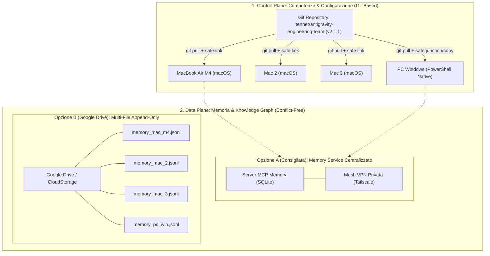

# 🛡️ Audit Report Congiunto: Antigravity_Brain Multi-Postazione (3 Mac + 1 PC)

**Data Audit:** 24 Ottobre 2026  
**Autore:** Collegio degli Agenti (`software-architect`, `security-auditor`, `qa-engineer`)  
**Target:** Sincronizzazione di Memoria, Competenze e Configurazioni su 3 Mac (incluso Apple Silicon M4) e 1 PC Windows  
**Oggetto del Test:** "Kit di Costruzione Integrale (Zero-Dependency)" su Google Drive con Symlink e Hooks  

---

## 1. Verdetto Formale Unanime del Team di Sub-Agenti

| Specialista | Verdetto Formale | Rischio Primario Evidenziato |
| :--- | :---: | :--- |
| **Lead Software Architect** | ❌ **REJECTED (Blocco Preventivo)** | **Perdita dati irreversibile** (28 skill piallate), regressione di versione a v2.0.0 obsoleta, split-brain della memoria su Google Drive. |
| **Adversarial Security Auditor** | 🔴 **RESPINTO (2 Critical, 3 High)** | `rm -rf` indiscriminato (CWE-284), `safety_gate.py` con Fail-Open e bypass regex (CWE-1188/CWE-693), Flag Injection nel formatter (CWE-88). |
| **Lead QA & Reliability Engineer** | ❌ **RESPINTO PENDING REMEDIATION** | Rottura totale su Windows (PowerShell incompatibile con `ln -s`, `python3` mancante che congela l'IDE), file locking Win32 `EBUSY`, conflitti `(1).jsonl`. |

> [!CAUTION]
> **NON ESEGUIRE LO SCRIPT PROPOSTO NELLO STATO ATTUALE:**  
> L'esecuzione sul tuo Mac distruggerebbe immediatamente le **28 skill operative** e il plugin **`engineering-team` v2.1.1** appena perfezionato, sostituendoli con una vecchia versione 2.0.0 priva di contraddittorio e priva di protezioni. Inoltre, su Windows bloccherebbe l'intero funzionamento di Antigravity.

---

## 2. Matrice dei Rilievi e Vettori di Rottura

### A. Rischio Distruzione Dati e Regressione (Critico)
1. **Cancellazione Massiva Cieca (SEC-01 / ARCH-01)**:
   ```bash
   rm -rf ~/.gemini/config/rules ~/.gemini/config/skills ~/.gemini/config/plugins ~/.gemini/config/hooks...
   ```
   Cancella tutte le cartelle locali preesistenti prima ancora di verificare se Google Drive è montato e funzionante. Se il demone di Google Drive non è avviato o il percorso cambia, l'ambiente locale rimane azzerato senza possibilità di rollback.
2. **Downgrade Silenzioso a v2.0.0**:
   Lo script re-installa i prompt v2.0.0, cancellando le correzioni v2.1.1:
   - Viene persa la regola di **Anti-Sycophancy** (il contraddittorio avversariale).
   - Viene persa la **Target Environment Awareness** (macOS vs Linux/Docker vs Windows).
   - Vengono persi i **Quality Gate vincolanti** (`[APPROVATO]`, `[RESPINTO]`).

### B. Incompatibilità Totale su PC Windows (QA-Blockers)
1. **`bash` & `ln -s` su Windows (`TC-WIN-01`, `TC-WIN-02`)**:
   - Da PowerShell o CMD standard, lo script Bash non è eseguibile.
   - Su Windows NTFS, i symlink richiedono la *Modalità Sviluppatore* o privilegi di Amministratore (errore `WinError 1314: A required privilege is not held by the client`).
   - Le *NTFS Junctions* (`mklink /J`) funzionano solo tra cartelle locali NTFS, ma falliscono sui dischi virtuali generati da Google Drive for Desktop (`G:\`).
2. **Deadlock Totale dell'IDE per `python3` Mancante (`TC-WIN-03`)**:
   - Su Windows, il binario di Python si chiama `python.exe` o `py.exe`; `python3` non esiste nel PATH di default.
   - Poiché `hooks.json` dichiara `"command": "python3 ~/.gemini/config/hooks/safety_gate.py"` prima di ogni tool execution (`PreToolUse`), il fallimento del comando blocca qualsiasi tool call dell'agente (*fail-closed*), **rendendo Antigravity completamente paralizzato su Windows**.

### C. Concorrenza e File Locking su Google Drive
1. **Split-Brain e File di Conflitto (`TC-SYN-01`, `SEC-05`)**:
   - Google Drive non implementa lock a livello di transazioni ACID.
   - Se 2 computer sono accesi ed entrambi gli agenti aggiornano `memory_graph.jsonl`, Google Drive crea copie di conflitto: `memory_graph (1).jsonl`. Le due macchine divergono e la memoria si frammenta.
2. **Sharing Violation su Windows (`TC-SYN-03`)**:
   - Mentre Google Drive sincronizza un file aperto in scrittura, acquisisce un lock esclusivo Win32: Antigravity solleverà eccezioni non gestite `PermissionError: [WinError 32]`.
3. **macOS FileProvider Eviction (`TC-SYN-02`)**:
   - Su macOS, Google Drive archivia i file meno usati come puntatori *dataless* (file stub). All'accesso, la syscall di lettura si blocca in attesa del download di rete; se la connessione è assente o lenta, Antigravity va in timeout e crasha.

### D. Vulnerabilità nei Lifecycle Hooks
1. **Fail-Open Critico in `safety_gate.py` (`SEC-02`)**:
   ```python
   except Exception:
       print(json.dumps({"decision": "allow"})) # FAIL-OPEN VULNERABILE
   ```
   Se un comando o prompt malevolo causa un'eccezione (es. payload annidato, caratteri invalidi o timeout), il gate risponde `allow`, lasciando passare qualsiasi comando distruttivo.
2. **Bypass Regex su `json.dumps(payload)` (`SEC-03`)**:
   La regex `rm -rf` cerca stringhe letterali nel JSON, ma viene elusa banalmente tramite encoding Unicode (`\u0072\u006d`), subshell `$()`, variabili shell o quoting (`r'm' -'r'f`).
3. **Flag Injection in `auto_formatter.sh` (`SEC-04`)**:
   Il passaggio di `FILE_PATH` non sanitizzato a `prettier` o `ruff` consente l'iniezione di flag CLI (es. `--config=malicious.js`), aprendo all'esecuzione di codice arbitrario.

---

## 3. L'Architettura Riprogettata: Sincronizzazione a Due Livelli

Per sincronizzare 3 Mac e 1 PC in totale sicurezza ed efficienza, separiamo rigorosamente il **Control Plane** (configurazioni statiche, versionate e deterministiche) dal **Data Plane** (memoria dinamica ad alta frequenza).



---

## 4. Specifiche Tecniche della Soluzione Rifattorizzata

### 4.1 Gestione delle Competenze (Control Plane)
1. **Nessun `rm -rf` distruttivo**:  
   Gli script di allineamento eseguono sempre una copia di backup prima di toccare i file: `~/.gemini/config_backup_<timestamp>`.
2. **Script Bivalente**:
   - `bootstrap_mac.sh` per i 3 Mac (POSIX con `ln -sfn`).
   - `bootstrap_win.ps1` per Windows (PowerShell nativo che rileva se abilitare symlink o junction senza richiedere UAC).
3. **Conservazione della v2.1.1**:  
   Il plugin `engineering-team` rimane collegato al repository ufficiale GitHub `tennet/antigravity-engineering-team`, garantendo gli standard di contraddittorio avversariale e quality gate.

### 4.2 Gestione della Memoria Multi-Postazione (Data Plane)
Per evitare collisioni di file su Google Drive, adottiamo una delle due soluzioni sicure:

- **Strategia 1 (Local-First Multi-File su Drive - Zero Costi)**:  
  Ogni computer scrive **esclusivamente sul proprio file dedicato**:
  - `knowledge/memory_mac_m4.jsonl`
  - `knowledge/memory_mac_studio.jsonl`
  - `knowledge/memory_pc_workstation.jsonl`  
  In questo modo Google Drive non genererà mai copie di conflitto `(1).jsonl`. All'avvio dell'agente, una routine di lettura legge e fonde i file in sola lettura, deduplicando le entità per timestamp.
- **Strategia 2 (Server MCP Remoto via Tailscale)**:  
  Un Mac o una VPS ospita il server MCP Memory (SQLite transazionale). Tutti i nodi vi accedono via rete cifrata, garantendo consistenza ACID in tempo reale.

### 4.3 Hardening dei Lifecycle Hooks
1. **`safety_gate.py` Riscritto (Fail-Secure + Tokenizzazione AST)**:
   - Sostituita la regex con `shlex.split()`.
   - Se si verifica qualsiasi eccezione o errore di parsing, il gate risponde rigorosamente **`deny`** (Fail-Secure).
2. **Risoluzione Polimorfica di Python**:
   - Lo script wrapper verifica `sys.executable`, `python`, `py -3` o `python3`, eliminando il blocco dell'IDE su Windows.
3. **`auto_formatter.sh` Hardened**:
   - Confinamento al workspace (`realpath`), verifica file regolare e protezione con `--` contro option hijacking.
