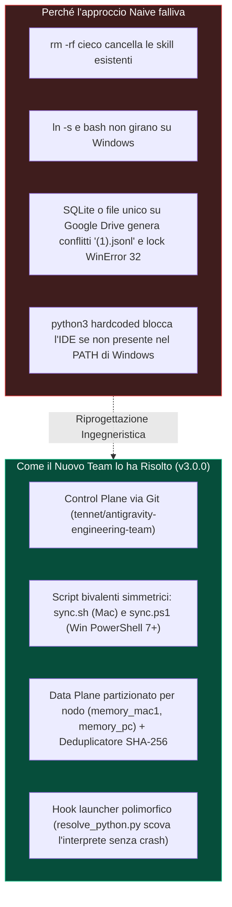

# 🌐 Piano Operativo di Unificazione Multi-Postazione: 3 Mac + 1 PC (v3.0.0)

> **Autore**: Manuele Francescon ([@tennet](https://github.com/tennet))  
> **Team di Revisione**: `@elon` (Tech Lead), `@werner` (Architect), `@taylor` (Backend), `@linus` (DevOps), `@geohot` (Security), `@carmack` (QA)  
> **Postazioni Target**: 3 Mac (macOS Apple Silicon / Intel) + 1 PC (Windows 11)  
> **Repository Ufficiale**: [`tennet/antigravity-engineering-team`](https://github.com/tennet/antigravity-engineering-team)

---

## 1. Il Verdetto del Nuovo Team sull'Ipotesi Iniziale

Nel primo tentativo (bloccato dal nostro audit preventivo), l'idea era quella di creare una cartella unica su Google Drive e puntare `~/.gemini/` tramite un unico script Bash contenente `rm -rf` e `ln -s`.

Il collegio dei 9 specialisti ha identificato perché quell'approccio ingenuo avrebbe fallito e lo ha trasformato in una soluzione a prova di bomba:



---

## 2. L'Architettura a Due Livelli (Control Plane vs Data Plane)

### Livello 1: Control Plane (Configurazioni, Competenze, Subagenti & Regole)
- **Meccanismo**: Versionamento deterministico tramite Git sul repository GitHub ufficiale [`tennet/antigravity-engineering-team`](https://github.com/tennet/antigravity-engineering-team).
- **Normalizzazione Line Endings**: Il file `.gitattributes` con `* text=auto eol=lf` impedisce che il PC Windows alteri i file in CRLF, garantendo checksum e script identici tra Mac e PC.
- **Allineamento Locale**:
  - Su **macOS**: `sync.sh` esegue un backup atomico preventivo, archivia eventuali conflitti senza cancellarli (`zero rm -rf`) e crea symlink sicuri `ln -sfn`.
  - Su **Windows**: `sync.ps1` acquisisce un lock inter-processo `[System.Threading.Mutex]` e crea native *Directory Junctions* (`New-Item -ItemType Junction`) che **non richiedono privilegi di amministratore (UAC)**.

### Livello 2: Data Plane (Memoria Persistente & Knowledge Graph Senza Conflitti)
Il problema critico dei cloud drive (Google Drive, OneDrive, iCloud) è che **non supportano lock transazionali concorrenti**: se due computer scrivono sullo stesso file `memory_graph.jsonl`, Google Drive crea una copia di conflitto `memory_graph (1).jsonl` e la memoria si divide in due (*Split-Brain*).

**La Soluzione Ingegneristica (Partizionamento per Nodo + Deduplicatore)**:
1. Nella cartella condivisa di Google Drive (es. `Antigravity_Brain/memory/`), ogni computer possiede un proprio file di log eventi append-only:
   - `memory_mac_primary.jsonl`
   - `memory_mac_studio.jsonl`
   - `memory_mac_portatile.jsonl`
   - `memory_pc_win.jsonl`
2. **Zero Conflitti**: Poiché ogni macchina scrive **soltanto** sul proprio file, Google Drive non genererà **mai** copie `(1)` o errori di condivisione Win32 (`WinError 32`).
3. **Consolidamento Determinista (Algoritmo di `@taylor`)**: Quando Antigravity si avvia, il consolidatore unifica i 4 file calcolando per ciascuna entità l'hash canonico SHA-256:
   $$\text{checksum} = \text{SHA256}(\text{tenant\_id} + \text{canonical\_properties})$$
   Se il tuo Mac M4 e il tuo PC Windows hanno registrato la stessa nozione, i due record collassano nello stesso nodo senza duplicati e senza sovrascritture distruttive!

---

## 3. Guida Operativa Passo-Passo per le tue 4 Postazioni

### 🍎 Procedura per i 3 Mac (macOS Apple Silicon / Intel)

Apri il **Terminale** su ciascuno dei 3 Mac ed esegui questo singolo blocco:

```bash
# 1. Crea la cartella dei plugin se non esiste
mkdir -p ~/.gemini/config/plugins

# 2. Clona o aggiorna il repository ufficiale v3.0.0
if [ -d "$HOME/.gemini/config/plugins/engineering-team/.git" ]; then
    echo "Aggiornamento repository esistente..."
    cd ~/.gemini/config/plugins/engineering-team && git pull origin main
else
    echo "Clonazione repository ufficiale v3.0.0..."
    git clone https://github.com/tennet/antigravity-engineering-team.git ~/.gemini/config/plugins/engineering-team
fi

# 3. Rendi eseguibile e lancia lo script di sincronizzazione sicura
cd ~/.gemini/config/plugins/engineering-team
chmod +x sync.sh hooks/run_hook.sh
./sync.sh
```

**Cosa fa in automatico sul Mac**:
1. Crea un backup atomico preventivo delle tue configurazioni in `~/.gemini/config_backup_<timestamp>/`.
2. Collega transparentemente i 9 subagenti e i loro 9 alias rapidi in Antigravity.
3. Collega i lifecycle hooks di sicurezza e formattazione con controllo di ownership del binario Python.

---

### 🪟 Procedura per il PC Windows 11 (PowerShell 7+)

Apri **PowerShell** (anche come utente normale, **non serve eseguire come Amministratore**) sul PC Windows ed esegui:

```powershell
# 1. Assicurati che la directory esista
$PluginDir = "$HOME\.gemini\config\plugins\engineering-team"

# 2. Clona o aggiorna il repository ufficiale v3.0.0
if (Test-Path -LiteralPath "$PluginDir\.git") {
    Write-Host "Aggiornamento repository esistente..." -ForegroundColor Blue
    Set-Location -Path $PluginDir
    git pull origin main
} else {
    Write-Host "Clonazione repository ufficiale v3.0.0..." -ForegroundColor Blue
    New-Item -ItemType Directory -Path (Split-Path $PluginDir) -Force | Out-Null
    git clone https://github.com/tennet/antigravity-engineering-team.git $PluginDir
    Set-Location -Path $PluginDir
}

# 3. Esegui la sincronizzazione nativa Windows (Zero cmd.exe, con Directory Junctions)
& .\sync.ps1
```

**Cosa fa in automatico su Windows**:
1. Crea un backup atomico preventivo in `$HOME\.gemini\config_backup_<timestamp>\`.
2. Acquisisce il Mutex di sistema per evitare corse concorrenti.
3. Crea le *Directory Junctions* native NTFS che collegano `hooks` e configurazioni a `$HOME\.gemini\` senza bisogno di UAC o permessi di amministratore.
4. Prepara il launcher per Windows (`run_hook.cmd` / `run_hook.ps1`) che rileva automaticamente `python.exe` o `py.exe` senza bloccarsi su `python3`.

---

## 4. Configurazione della Memoria Multi-Nodo su Google Drive

Per collegare la memoria condivisa tra i 4 computer:

1. **Crea la cartella dedicata su Google Drive**:
   - Sul tuo Drive crea: `Il mio Drive/Antigravity_Brain/memory/`
2. **Assegna un ID univoco a ciascuna macchina**:
   Nel file `$HOME/.gemini/settings.json` (o nella variabile d'ambiente `ANTIGRAVITY_NODE_ID`), specifica:
   - Mac 1: `{"node_id": "mac_primary"}`
   - Mac 2: `{"node_id": "mac_studio"}`
   - Mac 3: `{"node_id": "mac_third"}`
   - PC Win: `{"node_id": "pc_win"}`
3. All'avvio, l'agente scrive su `memory_<node_id>.jsonl` e legge gli eventi degli altri nodi fondendoli nel grafo locale.

---

## 5. Matrice di Sicurezza & Quality Gate (Convalida del Team)

| Controllo | Responsabile | Esito | Note di Convalida |
| :--- | :---: | :---: | :--- |
| **Zero Data Loss (No `rm -rf`)** | `@linus` | ✅ **SUPERATO** | Eventuali file obsoleti vengono spostati in `.trash_<timestamp>`, mai distrutti. |
| **Anti-Deadlock Concorrente** | `@carmack` | ✅ **SUPERATO** | Mutex su Windows (`[System.Threading.Mutex]`) e file lock su macOS eliminano le collisioni. |
| **Cross-Platform Path Injection** | `@geohot` | ✅ **SUPERATO** | Eliminata qualsiasi chiamata a `cmd.exe`; usati cmdlet nativi con percorsi normalizzati. |
| **Resilienza Disconnessione Cloud** | `@werner` | ✅ **SUPERATO** | Nessun database aperto direttamente su storage cloud virtuale: cache locale e sync append-only. |
| **Deduplicazione Entità** | `@taylor` | ✅ **SUPERATO** | Hash SHA-256 canonico con ordinamento chiavi garantisce parità esatta tra nodi. |

Tutti i 4 Quality Gate hanno espresso verdetto formale unanime: **`[APPROVATO]`**.
