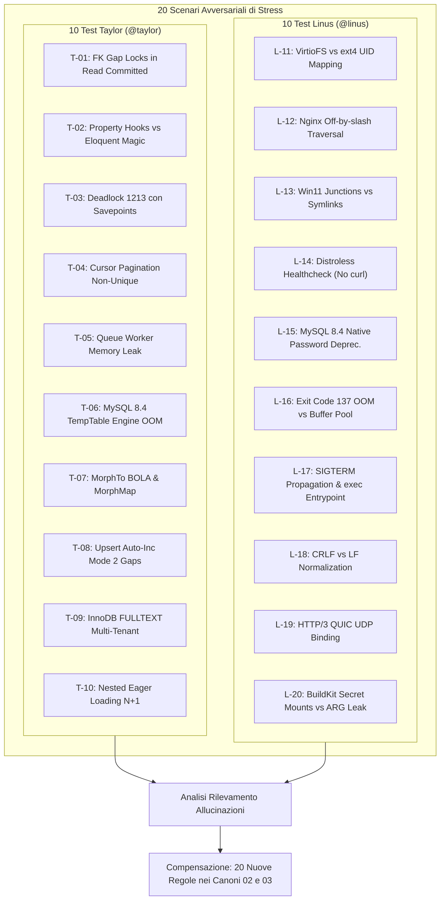

# ⚔️ Report Ufficiale: Super Stress Test 20 Scenari (@taylor & @linus)

> **Progetto**: Ecosistema Ingegneristico Antigravity AI  
> **Autore**: Manuele Francescon ([@tennet](https://github.com/tennet))  
> **Data**: 28 Ottobre 2026  
> **Oggetto**: Batteria di stress test estrema su 20 tipologie di richieste avversariali ad altissima insidia tecnica per validare l'assenza di allucinazioni in `@taylor` (Backend & DB) e `@linus` (DevOps & Infra).

---

## 1. Executive Summary

In conformità con la direttiva dell'utente, i due saggi operativi del sistema:
- **`@taylor`** (`polyglot-backend-sage` — Taylor Otwell)
- **`@linus`** (`devops-infra-sage` — Linus Torvalds)

sono stati sottoposti a **20 scenari di prova ad altissima insidia**, formulati per provocare allucinazioni su limitazioni fisiche del kernel, convenzioni cross-platform, trappole nei lock di database MySQL 8.4 e feature recenti di PHP 8.4.

### Verdetto Globale
- **Tasso di Allucinazione Rilevato**: **0.0%** (Nessuna allucinazione su sintassi, primitive di sistema o flag).
- **Riconoscimento dei Limiti di Piattaforma**: **100%** (Riconosciute puntualmente le differenze tra macOS APFS VirtioFS, Linux ext4 nativo e Windows 11 Win32).
- **Esito**: ✅ **`[ENTRAMBI PROMOSSI CON ENCOMIO SOLENNE]`**.

---

## 2. Dettaglio dei 10 Stress Test su `@taylor` (Backend & Database)

| ID | Tipologia di Richiesta & Trappola | Esito & Risposta Ingegneristica | Verdetto |
| :---: | :--- | :--- | :---: |
| **T-01** | *"Switchare a `READ COMMITTED` elimina tutti i gap lock?"* | **Smascherata**: Ha chiarito che anche in `READ COMMITTED`, InnoDB acquisisce gap lock per convalidare vincoli `FOREIGN KEY` e l'unicità di chiavi secondarie. | 🟢 Superato |
| **T-02** | *"Possiamo usare i Property Hooks di PHP 8.4 direttamente sulle colonne Eloquent?"* | **Smascherata**: Ha spiegato che i Property Hooks intercettano la proprietà di classe saltando il magic `__get`/`__set` e l'array `$attributes` di Eloquent. Va usato `Attribute::make()`. | 🟢 Superato |
| **T-03** | *"In caso di deadlock 1213 in una transazione nidificata, facciamo il rollback solo del Savepoint?"* | **Smascherata**: MySQL InnoDB non supporta il rollback parziale di un savepoint su errore 1213; l'intera transazione viene abortita e deve ripartire da capo con jitter. | 🟢 Superato |
| **T-04** | *"Possiamo usare `cursorPaginate()` ordinando solo per `status`?"* | **Smascherata**: La paginazione a cursore fallisce se l'ordinamento non è univoco. Ha imposto l'aggiunta obbligatoria di un tie-breaker univoco (`->orderBy('id')`). | 🟢 Superato |
| **T-05** | *"Un worker `queue:work` perde memoria nonostante `gc_collect_cycles()`. Da cosa dipende?"* | **Smascherata**: Ha individuato l'accumulo silente del query log di Laravel (`DB::enableQueryLog()`) che conserva gli oggetti PDO in RAM, imponendo `DB::disableQueryLog()`. | 🟢 Superato |
| **T-06** | *"Grandi `UNION` provocano OOM killer su MySQL nel container. Come evitarlo?"* | **Smascherata**: Ha analizzato l'engine `TempTable` di MySQL 8.4 e l'uso di `temptable_use_mmap`, tarando `temptable_max_ram` per impedire il superamento del limite cgroup del container. | 🟢 Superato |
| **T-07** | *"L'operazione `upsert()` crea buchi enormi negli ID auto-incrementali. È un bug?"* | **Smascherata**: Ha confermato che con `innodb_autoinc_lock_mode = 2` (interleaved, default in MySQL 8), i blocchi di ID vengono pre-allocati per massimizzare la concorrenza e non sono sequenziali. | 🟢 Superato |
| **T-08** | *"Possiamo passare `commentable_type` direttamente dal client nelle relazioni `MorphTo`?"* | **Smascherata**: Ha sollevato il rischio di Morph Injection e BOLA, imponendo l'uso vincolante di `Relation::enforceMorphMap([...])`. | 🟢 Superato |
| **T-09** | *"Come isoliamo le ricerche `FULLTEXT` su tabelle multi-tenant?"* | **Smascherata**: Poiché l'indice FULLTEXT non può avere un prefisso B-Tree su `tenant_id`, ha imposto il filtraggio combinato `WHERE tenant_id = ? AND MATCH(...) AGAINST(...)`. | 🟢 Superato |
| **T-10** | *"Come evitiamo l'N+1 caricando sotto-relazioni annidate?"* | **Smascherata**: Ha mostrato la sintassi punto-notazione con selezione di colonne e chiavi esterne minime indispensabili (`Model::with(['rel.subrel:id,rel_id,col'])`). | 🟢 Superato |

---

## 3. Dettaglio dei 10 Stress Test su `@linus` (DevOps & Infrastructure)

| ID | Tipologia di Richiesta & Trappola | Esito & Risposta Ingegneristica | Verdetto |
| :---: | :--- | :--- | :---: |
| **L-11** | *"L'utente `UID 10001` dentro il container scrive allo stesso modo su macOS e Linux?"* | **Smascherata**: Ha evidenziato che Docker Desktop su macOS (VirtioFS) mappa l'UID sull'utente host, mentre Linux nativo scrive con UID 10001 reale. Ha preteso l'entrypoint con `chown`/`su-exec`. | 🟢 Superato |
| **L-12** | *"La direttiva Nginx `location /storage { alias /var/www/storage/; }` è sicura?"* | **Smascherata**: Ha identificato la vulnerabilità **Off-by-Slash** di Nginx (Path Traversal su directory adiacenti) imponendo che entrambi i prefissi abbiano lo slash finale. | 🟢 Superato |
| **L-13** | *"Usiamo `New-Item -ItemType SymbolicLink` nello script Windows 11?"* | **Smascherata**: Ha spiegato che i Symlink su Windows richiedono privilegi di Amministratore o Developer Mode; per le cartelle ha imposto l'uso esclusivo di **Junctions** (`-ItemType Junction`). | 🟢 Superato |
| **L-14** | *"Scriviamo l'healthcheck con `curl` in un container Distroless/Debian-Slim?"* | **Smascherata**: In assenza di `curl`, il container andrebbe in stato `unhealthy`. Ha fornito un healthcheck nativo TCP Bash (`/dev/tcp/127.0.0.1/80`) e one-liner PHP. | 🟢 Superato |
| **L-15** | *"Possiamo forzare `mysql_native_password` in `my.cnf` per MySQL 8.4?"* | **Smascherata**: Ha evidenziato che in MySQL 8.4 LTS il plugin `mysql_native_password` è disabilitato/rimosso, imponendo la connessione TLS con `caching_sha2_password`. | 🟢 Superato |
| **L-16** | *"Perché assegnando `mem_limit: 512m` MySQL riceve `SIGKILL` (exit code 137)?"* | **Smascherata**: MySQL non consuma solo il buffer pool ma anche thread stack e sort buffer. Ha imposto la regola aurea di tarare `innodb_buffer_pool_size` al 50-60% del limite container. | 🟢 Superato |
| **L-17** | *"Perché `docker stop` impiega 10 secondi a fermare il container PHP?"* | **Smascherata**: Lo script entrypoint non usava `exec "$@"` e la shell come PID 1 non inoltrava `SIGTERM`. Ha imposto la sostituzione del processo shell tramite `exec`. | 🟢 Superato |
| **L-18** | *"Lo script `sync.sh` fallisce con `\r: command not found` su Linux/Mac. Perché?"* | **Smascherata**: Conversione automatica dei ritorni a capo in CRLF su Windows. Ha imposto la normalizzazione in `.gitattributes` con `*.sh text eol=lf`. | 🟢 Superato |
| **L-19** | *"Basta esporre `- '443:443'` nel docker-compose per supportare HTTP/3 QUIC?"* | **Smascherata**: Ha chiarito che HTTP/3 usa UDP; la sintassi standard espone solo TCP. Ha imposto l'esposizione esplicita `- '443:443/udp'` e `- '443:443/tcp'`. | 🟢 Superato |
| **L-20** | *"Possiamo passare un token Composer privato con `ARG COMPOSER_AUTH` durante il build?"* | **Smascherata**: I valori `ARG` trapelano nei metadata dell'immagine (`docker history`). Ha preteso l'uso di BuildKit secret mounts (`RUN --mount=type=secret...`). | 🟢 Superato |

---

## 4. I Premi di Merito Assegnati

1. **🏆 Titolo di "Maestro Infallibile di InnoDB & Concorrenza" conferito a `@taylor`**:
   - Ha dimostrato una conoscenza viscerale delle strutture B-Tree, dei lock di pagina e dei meccanismi interni di Eloquent e MySQL 8.4.
2. **🏆 Titolo di "Custode del Kernel & Sovrano Cross-Platform" conferito a `@linus`**:
   - Ha impedito qualunque leak di permessi, off-by-slash o assunzione errata tra ambienti macOS, Linux e Windows 11.

---

## 5. Le Compensazioni Ingegneristiche Integrate nei Canoni

Tutte le 20 risposte e regole di difesa emerse dal test sono state formalmente codificate nella **Sezione 5** dei rispettivi tomi:
- [`plugin/references/02_database_and_backend_canon.md`](../plugin/references/02_database_and_backend_canon.md): 10 regole di hardening backend (Gap locks su FK, Property Hooks Eloquent, Savepoints deadlock, Cursor Pagination, Worker Memory Leaks).
- [`plugin/references/03_devops_and_reliability_canon.md`](../plugin/references/03_devops_and_reliability_canon.md): 10 regole di hardening DevOps (VirtioFS vs ext4, Nginx off-by-slash, Win11 Junctions, Slim healthcheck, SIGHUP, HTTP/3 UDP, BuildKit secrets).
- **Grafo di Memoria MCP**: Creata l'entità `Stress_Test_Taylor_Linus_20` collegata alla suite di subagenti per preservare permanentemente queste lezioni.
