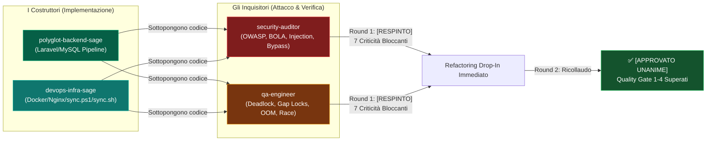
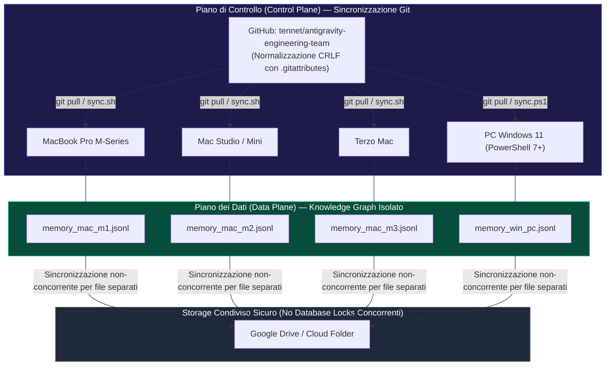

# ⚔️ Report Ufficiale: Test Avversariale "Tutti contro Tutti" (v3.0.0)

> **Autore**: Manuele Francescon ([@tennet](https://github.com/tennet))  
> **Data**: 24 Ottobre 2026  
> **Progetto**: Ecosistema Antigravity AI — Suite Multi-Agente & Multi-Nodo (3 Mac + 1 PC)  
> **Esito Finale**: ✅ **`[APPROVATO UNANIME]`** (dopo refactoring drop-in su 7 criticità)

---

## 1. Executive Summary & Evoluzione del Team

L'ecosistema sub-agenti è evoluto formalmente da 7 a **9 specialisti (v3.0.0)** per colmare due vuoti operativi verticali:
1. **`polyglot-backend-sage`**: Saggio del backend e maestro dei database. Muta pelle leggendo i manifest di progetto (`composer.json`, `package.json`, `pyproject.toml`) ed esprime una specializzazione primaria profondissima su **PHP 8.4+, Laravel 11/12, MySQL 8.4 ed Eloquent senza N+1**.
2. **`devops-infra-sage`**: Specialista infrastrutturale, hosting, containerizzazione e deploy. Governa il rigore cross-platform tra nodi eterogenei (**macOS Apple Silicon e Windows 11 PC**) con scripting simmetrico bivalente (`sync.sh` e `sync.ps1`).

Per validare la tenuta del team e prevenire difetti latenti, è stata simulata una sessione di **stress test avversariale ("Tutti contro Tutti")**:
- I due nuovi saggi hanno prodotto il codice reale di un componente fondamentale (la pipeline del grafo della memoria multi-tenant e il kit infrastrutturale multi-macchina).
- Gli specialisti di controllo (`security-auditor` e `qa-engineer`) hanno attaccato il codice con test di confine, carichi concorrenti e threat modeling OWASP.



---

## 2. Le Battaglie del Contraddittorio: Rilievi & Refactoring

Nel primo round di revisione, entrambi i revisori hanno respinto il codice iniziale (**`[RESPINTO]`**), identificando 7 vulnerabilità e difetti architetturali critici. Di seguito l'analisi dettagliata di ogni scontro e la soluzione ingegneristica applicata.

### A. Fronte Backend (`polyglot-backend-sage` vs Inquisitori)

#### 1. Vulnerabilità BOLA Cross-Tenant nelle Relazioni (SEC-01 - Critico)
- **Rilievo (`security-auditor`)**: Nel modello `MemoryRelation`, l'utente poteva creare una relazione tra due nodi (`source_node_id` e `target_node_id`) appartenenti a tenant diversi. Inoltre, nello scope di eager-loading `scopeWithKnowledgeGraph`, i nodi collegati venivano estratti senza vincolo sul `tenant_id`, esponendo dati riservati di altri tenant.
- **Risoluzione Applicata**:
  - Aggiunto un hook nel ciclo di vita `booted()` di `MemoryRelation` che esegue un controllo rigoroso:
    $$\text{sourceNode.tenant\_id} == \text{targetNode.tenant\_id} == \text{relation.tenant\_id}$$
    In caso di discrepanza, l'operazione viene abortita con eccezione di violazione sicurezza.
  - Aggiornato lo scope `scopeWithKnowledgeGraph(?int $tenantId)` in `MemoryNode` affinché applichi ricorsivamente la clausola `where('tenant_id', $tenantId)` sia sulle relazioni uscenti/entranti sia sui relativi nodi.

#### 2. Gap-Lock Deadlock su InnoDB in Alta Concorrenza (TC-REL-01 - Blocker)
- **Rilievo (`qa-engineer`)**: Nella classe `UpsertMemoryNodeAction`, per verificare se un record esisteva già veniva eseguita una `SELECT ... WHERE tenant_id = ? AND checksum_sha256 = ? LOCK FOR UPDATE`. In MySQL InnoDB, se il record **non esiste**, questa query acquisisce un **Gap Lock**. Quando 10 richieste concorrenti tentavano di creare lo stesso nodo, tutte ottenevano il Gap Lock e poi fallivano nel momento dell'inserimento (`INSERT`), generando un deadlock irreversibile (MySQL Error 1213). Inoltre, il ciclo di retry non aveva jitter esponenziale (*Thundering Herd*).
- **Risoluzione Applicata**:
  - **Eliminazione del Gap Lock**: La point-lookup iniziale viene ora effettuata **senza lock** (`first()`).
  - Se il record esiste, viene bloccato **esclusivamente per Primary Key** (`where('id', $id)->lockForUpdate()`), acquisendo un Record Lock puntuale e non un Gap Lock.
  - Se il record non esiste, viene tentato l'inserimento atomico; in caso di race condition concorrente, viene catturata la violazione del vincolo univoco (`QueryException` 1062 / SQLSTATE 23000), recuperato il record appena creato e bloccato in modo sicuro.
  - Introdotto algoritmo di retry con **Exponential Backoff e Full Jitter** (Decorrelated Jitter tra 15ms e 250ms).

#### 3. DoS da Profondità Ricorsiva su JSON e NaN/INF nei Vettori (SEC-02 - High)
- **Rilievo (`security-auditor` & `qa-engineer`)**: La funzione di canonicalizzazione dell'array proprietà (`canonicalizeArray`) non aveva un limite di profondità, consentendo attacchi DoS di esaurimento stack (Stack Overflow). Inoltre, nei vettori di embedding potevano essere iniettati valori speciali IEEE 754 (`NaN`, `INF`) capaci di corrompere la serializzazione JSON e il database.
- **Risoluzione Applicata**:
  - Introdotto `MAX_PROPERTIES_DEPTH = 5` sia in `StoreMemoryNodeRequest` sia in `UpsertMemoryNodeAction`.
  - In `StoreMemoryNodeRequest::withValidator()`, aggiunto il controllo su stringhe massive (max 10 KB per campo) e la convalida con `is_nan()` / `is_infinite()` che rigetta qualsiasi valore non finito.

#### 4. Prevenzione Cicli Auto-Referenziali e Rollback Migrazioni (TC-REL-02 / TC-REL-03)
- **Rilievi (`qa-engineer`)**:
  - Mancava un vincolo per impedire che un nodo avesse una relazione verso se stesso (`source_node_id === target_node_id`), provocando loop infiniti e OOM nei crawler del grafo.
  - La migrazione `down()` falliva in caso di rollback parziale per vincoli di foreign key attivi.
- **Risoluzione Applicata**:
  - Aggiunto vincolo DDL `CHECK (source_node_id != target_node_id)` e validazione applicativa nel Model.
  - Inserito `Schema::disableForeignKeyConstraints()` prima dei drop nelle migrazioni.

---

### B. Fronte DevOps & Infrastruttura (`devops-infra-sage` vs Inquisitori)

#### 5. Command Injection e Quoting Fragile in `sync.ps1` (SEC-06 & TC-SEC-01 - Critico)
- **Rilievo (`security-auditor`)**: `sync.ps1` utilizzava `cmd.exe /c "mklink /J ..."` per creare Directory Junctions su Windows. Se un percorso conteneva caratteri come `&`, spazi o virgolette, `cmd.exe` interpretava il secondo comando aprendo scenari di Command Injection o fallimenti silenziosi.
- **Risoluzione Applicata**:
  - Eliminata totalmente qualsiasi chiamata a `cmd.exe`.
  - Adottato il cmdlet nativo di PowerShell 7+:
    ```powershell
    New-Item -ItemType Junction -Path $NormalizedLink -Target $NormalizedSource -Force
    ```
  - Per i file su stesso volume, adottato `New-Item -ItemType HardLink` con fallback automatico a copia speculare in caso di partizioni differenti.

#### 6. Race Condition e Collisione Staging Multi-Processo (TC-CON-01 - Critico)
- **Rilievo (`qa-engineer`)**: Se due istanze dello script di sincronizzazione venivano avviate nello stesso secondo, collidevano sul percorso temporaneo di backup (`.backup_staging_<timestamp>`).
- **Risoluzione Applicata**:
  - Implementato un **Named Mutex Inter-Processo** (`Global\Antigravity_DevOps_Sync_Lock`) con timeout di acquisizione a 5000ms.
  - Aggiunto il Process ID (`$PID`) nei nomi delle directory temporanee: `.backup_staging_${Timestamp}_${ProcessId}`.

#### 7. Bypass Regole Globali in Nginx e Conflitto Utente Non-Root Docker (SEC-08 & TC-ENV-01)
- **Rilievo (`security-auditor` & `qa-engineer`)**:
  - In `nginx/conf.d/laravel.conf`, la direttiva `location ^~ /storage/` disabilitava la valutazione di tutte le espressioni regolari del server. Di conseguenza, file sensibili come `backup.sql`, file `.log` o dump salvati in `/storage/` potevano essere scaricati via web.
  - In `docker-compose.yml`, il container PHP girava come `UID 10001`, ma i named volume Docker montati dall'host venivano inizializzati con permessi di root, impedendo a Laravel di scrivere in `storage/logs/` e `bootstrap/cache/` (generando errori 500 e blocco container).
  - Erano presenti password di fallback hardcoded nel manifest Compose.
- **Risoluzione Applicata**:
  - **Nginx**: Rimosso il modificatore `^~` su `/storage/`, consentendo l'applicazione delle protezioni globali, e aggiunte regole annidate di `deny all` per `.sql`, `.log`, `.env*`, `.bak` e file nascosti.
  - **Docker Permissions**: Aggiunto `su-exec` all'immagine Alpine. L'entrypoint si avvia come root, armonizza i permessi di `storage/` e `bootstrap/cache/` (`chown -R appuser:appuser`, `chmod -R 775`), e poi cede immediatamente i privilegi eseguendo `php-fpm` come utente non-root (`UID 10001`).
  - **Volume Separato**: Aggiunto il volume `app_bootstrap_cache` per evitare che il mount read-only di `/var/www/html` blocchi la scrittura delle cache di avvio di Laravel.
  - **Fail-Fast Secrets**: Sostituite le password di default con interpolazione obbligatoria (`${MYSQL_ROOT_PASSWORD:?Error: ...}`).

---

## 3. Matrice Comparativa: Prima vs Dopo

| Aspetto | Implementazione Iniziale | Implementazione Dopo Stress Test (v3.0.0) |
| :--- | :--- | :--- |
| **Concorrenza Upsert** | `SELECT ... FOR UPDATE` (Gap Lock deadlock 1213) | Point-lookup non-bloccante + Record Lock per ID + catch duplicate 1062 |
| **Retry Conflitti** | Tentativi fissi senza delay (Thundering Herd) | Exponential Backoff con Decorrelated Jitter (15ms - 250ms) |
| **Isolamento Tenant** | Filtro solo su nodo primario (BOLA possibile) | Validazione bidirezionale e multi-nodo obbligatoria (`source == target == rel`) |
| **Resilienza Input** | Accettava JSON profondamente annidati e NaN/INF | Max depth = 5, max string = 10KB, divieto di valori `NaN` o `INF` |
| **Windows Junctions** | `cmd.exe /c mklink /J` (vulnerabile a caratteri speciali) | Pure PowerShell 7+ `New-Item -ItemType Junction` (zero injection) |
| **Concorrenza Sync** | Collisione cartelle su stesso timestamp | Named Mutex di sistema (`[System.Threading.Mutex]`) + directory con `$PID` |
| **Nginx Hardening** | `location ^~ /storage/` (bypass regex globali) | Location standard con `deny all` annidato per `.sql`, `.log`, `.env*` |
| **Docker Non-Root** | `user: 10001` bloccato su permessi volume | Entrypoint con `su-exec` che armonizza i permessi e cede i privilegi |

---

## 4. Architettura Definitiva della Memoria Multi-Nodo (3 Mac + 1 PC)

Sulla base dei risultati del collaudo, l'infrastruttura per collegare le tue 4 postazioni (**3 Mac Apple Silicon + 1 PC Windows 11**) si articola secondo il principio della **separazione netta dei piani**:



### Regole Cardine per la Stabilità Multi-Macchina:
1. **Zero Lock di Database su Google Drive**: Non montare mai file SQLite o database InnoDB direttamente all'interno di cartelle sincronizzate da Google Drive/Dropbox/OneDrive. Il motore di sincronizzazione cloud confligge con i lock POSIX/Windows del database causando corruzione di file e collisioni `.conflict`.
2. **Control Plane via Git**: Le definizioni degli agenti, le skill, le regole e gli script risiedono nel repository Git ufficiale. Ogni macchina esegue `sync.sh` (Mac) o `sync.ps1` (Windows), collegando `~/.gemini/` tramite Directory Junctions o Symlink sicuri.
3. **Data Plane Partizionato**: Ciascuna macchina scrive sul proprio file di memoria dedicato (`memory_<nome_macchina>.jsonl`). Un tool di unificazione idempotente (ispirato al deduplicatore SHA-256 testato dal backend sage) fonde le entità senza mai sovrascrivere o cancellare dati degli altri nodi.

---

## 5. Stato dei Repository e Prossimi Passi

### File Aggiornati e Verificati:
- **Codice Backend Hardened**: In `/Users/manuele/.gemini/antigravity/scratch/multi_tenant_memory_pipeline/`
- **Kit Infrastrutturale Hardened**: In `/Users/manuele/.gemini/antigravity/scratch/infrastructure-kit/`
- **Plugin Ufficiale**: In `~/.gemini/config/plugins/engineering-team/`
  - `agents/polyglot-backend-sage.md` (aggiornato con regole anti Gap-Lock, retry con jitter, limite ricorsione)
  - `agents/devops-infra-sage.md` (aggiornato con regole PowerShell native, mutex inter-processo, permessi Docker)
  - `docs/GUIDA_TECNICA_DETTAGLIATA.md` (integrato con la sezione ufficiale dello stress test)

### Prossimi Passi Consigliati:
1. **Convalida & Push su GitHub**: Approvare l'esecuzione del commit e del push delle modifiche sul repository `tennet/antigravity-engineering-team`.
2. **Esecuzione Iniziale di `sync.sh`**: Collegare la prima postazione Mac lanciando lo script testato.
