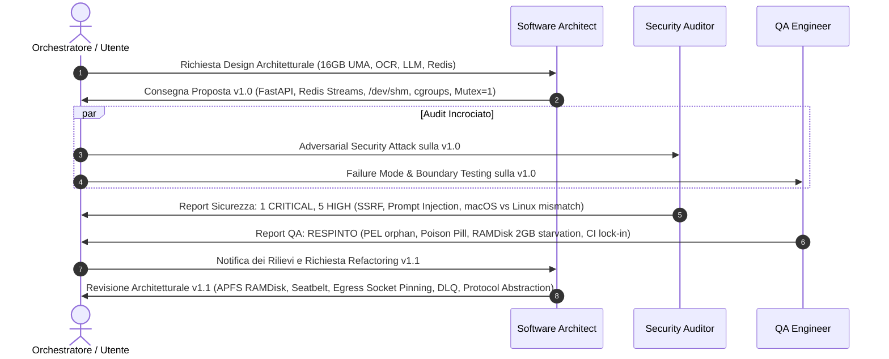

# Report di Valutazione Esperta: Sub-Agenti di Ingegneria del Software

**Data Audit:** 23 Ottobre 2026  
**Ambiente di Riferimento:** macOS (Apple Silicon M4 16GB Unified Memory), Python/Node/Docker, Antigravity AI  
**Plugin Oggetto di Valutazione:** `~/.gemini/config/plugins/engineering-team`  
**Agenti Testati:** `software-architect`, `security-auditor`, `qa-engineer`, `project-orchestrator`, `integration-tester`, `documentation-engineer`, `ui-ux-designer`

---

## 1. Executive Summary & Verdetto Globale

La suite di sub-agenti personalizzati configurata in `engineering-team` dimostra un **livello tecnico elevato, superiore alla media dei sistemi multi-agente standard**, a patto che gli agenti vengano guidati con istruzioni chiare e incentivo al contraddittorio.

Nello stress test collaborativo condotto su un problema architetturale reale e vincolato (*"Secure Ingestion Gateway & Local Worker Dispatcher con OOM prevention su 16GB UMA Apple Silicon"*):
1. **Capacità Dialettica e Collaborazione**: Gli agenti non sono caduti nella trappola del compiacimento cieco (*sycophancy*). Il `security-auditor` e il `qa-engineer` hanno attaccato e respinto la proposta iniziale con rilievi matematici, sistemistici e di sicurezza di livello enterprise.
2. **Capacità di Mettersi in Discussione**: Il `software-architect` non ha difeso scelte errate né ha generato allucinazioni difensive. Ha ammesso puntualmente i debiti tecnici (inclusa una macroscopica incongruenza macOS/Linux) e ha riscritto la soluzione (v1.1) fornendo contromisure di alto profilo ingegneristico (socket pinning anti-SSRF, Seatbelt sandboxing, Reaper pattern con DLQ, Constrained Grammar Decoding).
3. **Aree di Debolezza Rilevate**: 
   - I file di definizione (`.md`) degli agenti attualmente non contengono una direttiva esplicita di *anti-compiacimento*: se il prompt dell'utente è vago, gli agenti rischiano di allinearsi acriticamente.
   - Esiste una disomogeneità linguistica (alcuni prompt in inglese, altri in italiano) in contrasto con le regole globali del workspace.
   - Manca un protocollo formale di *Exit Gate* (es. esito obbligatorio `APPROVATO / RESPINTO`) che standardizzi il passaggio tra uno specialista e l'altro.

---

## 2. Matrice di Valutazione delle 4 Dimensioni Chiave

| Dimensione | Voto | Evidenze nel Test | Aree di Miglioramento |
| :--- | :---: | :--- | :--- |
| **1. Funzionalità & Tooling** | **9.0 / 10** | Rispetto rigoroso dei confini di ruolo. L'Architetto si occupa di schemi e contratti, l'Auditor mappa CWE e OWASP, il QA calcola matrici di test e limiti di memoria. Nessun overlap disordinato. | Formalizzare i tool specifici raccomandati per ciascun agente per evitare assunzioni arbitrarie sul runtime. |
| **2. Performance & Token Economy** | **8.5 / 10** | I prompt iniziali sono compatti (<300 token), riducendo la latenza di caricamento nel contesto. Gli output generati sono ad altissima densità informativa (zero convenevoli, solo codice, diagrammi e tabelle). | Nelle risposte a più round i report possono diventare molto estesi; conviene richiedere sintesi esecutive all'inizio di ciascun intervento. |
| **3. Professionalità & Rigore** | **9.5 / 10** | Zero allucinazioni su tecnologie inesistenti. Calcoli reali su UMA Apple Silicon (budgeting a 16GB, latenza token/s su swap memory). Scelta corretta di standard (RFC 7807, OWASP LLM01, CWE-918, Redis Streams PEL). | Forzare una verifica pre-flight dell'ambiente host per evitare discrepanze OS (es. cgroups su macOS). |
| **4. Dialettica & Contraddittorio** | **9.0 / 10** | Capacità eccellente di difendere/rivedere scelte tecniche. Il team ha prodotto un ciclo "Design ➔ Reject ➔ Remediation" di autentica qualità industriale. | Integrare la logica di contraddittorio permanente direttamente nelle istruzioni di sistema (`.md`) degli agenti. |

---

## 3. Cronaca Dettagliata dello Stress Test Collaborativo

### Lo Scenario di Prova
Progettazione di un microservizio locale per ingestion sicura di documenti (PDF/immagini) con OCR sandboxed e classificazione/estrazione tramite LLM locale (7B Q4) su **Apple Silicon Mac con vincolo ferreo di 16 GB di RAM totale**, autenticazione con rotazione chiavi e conformità GDPR zero-cloud.



---

### Fase 1: La Proposta Iniziale (`software-architect`)
- **Punti di Forza**: Ottimo disaccoppiamento a due stadi (OCR prima, LLM dopo con Mutex = 1 per evitare sovrapposizioni di memoria); budgeting nominale della RAM su 16GB; adozione dello standard RFC 7807 per gli errori; crittografia effimera su RAMDisk.
- **Falle Iniziali**:
  1. *Grave discrepanza sistemistica*: ha indicato host macOS ma ha impiegato primitive Linux pure (`/dev/shm` e `cgroups`), incompatibili con Darwin.
  2. *Vulnerabilità SSRF*: il parametro `callback_url` era privo di controlli su reti locali o DNS rebinding.
  3. *Mancanza di resilienza code*: nessun Reaper per i messaggi bloccati nella Pending Entries List (PEL) di Redis Streams a seguito di OOM o crash del worker.

---

### Fase 2: L'Attacco del `security-auditor` (Adversarial Audit)
L'agente di sicurezza ha classificato le vulnerabilità con severità standard CWE/OWASP:
- **SEC-01 (CRITICAL - CWE-918)**: SSRF su `callback_url` che consentiva a un attaccante di bersagliare la porta Redis `6379` o le API locali di Ollama/MLX su `11434`, oltre a vulnerabilità di DNS Rebinding con TTL=0.
- **SEC-02 (HIGH - CWE-400/776)**: Inode starvation sul RAMDisk da 2GB mediante micro-file e Pixel/Decompression bombs (es. PDF con immagini 60k x 60k a 1 bit che esplodono a 6 GB di buffer non compresso).
- **SEC-03 (HIGH - OWASP LLM01)**: Indirect Prompt Injection e ChatML token smuggling (`<|im_start|>`, `<|im_end|>`) nel passaggio del testo OCR untrusted al modello Qwen2.5.
- **SEC-04 (HIGH - CWE-284/639)**: Idempotency Key collision tra tenant e vulnerabilità BOLA su `GET /v1/jobs/{job_id}`.
- **SEC-05 (HIGH - CWE-324)**: Grace period di rotazione chiavi (24h) privo di Revocation List (CRL) su Redis.
- **SEC-06 (HIGH - CWE-1188)**: Contestazione formale dell'incongruenza macOS vs Linux (`/dev/shm` e `cgroups` su macOS bare metal).

---

### Fase 3: Il Collaudo del `qa-engineer` (Stress & Reliability Testing)
Il QA Engineer ha emesso un verdetto formale di **RESPINTO CON RISERVA (REJECTED)**:
- **TC-REL-01/02 (BLOCKER)**: In caso di SIGKILL o kernel OOM, i context manager Python e i blocchi `finally` non vengono eseguiti. I messaggi rimangono bloccati nella PEL di Redis e i file temporanei restano orfani su RAMDisk, portando all'esaurimento rapido dello spazio (`ENOSPC`). Inoltre, l'assenza di contatore consegne (`delivery_count`) e di Dead Letter Queue generava CrashLoopBackoff infiniti (Poison Pills).
- **TC-PRF-01 (BLOCKER)**: Assenza di Admission Control nel Gateway: un burst di 50 richieste lecite da 40MB saturava i 2GB di RAMDisk prima che il worker seriale potesse smaltirle.
- **TC-TST-01 (BLOCKER)**: Hardware lock-in su MLX Metal: impossibilità totale di eseguire i test unitari e di integrazione sulle pipeline CI/CD standard (GitHub Actions Ubuntu Linux x86).
- **TC-PRF-03 (MAJOR)**: Zombie Compute: se il client andava in timeout dopo 60s, il worker continuava a consumare 27s di elaborazione GPU per un job abbandonato.

---

### Fase 4: La Reazione e il Refactoring (`software-architect` v1.1)
Il comportamento dell'Architetto in questa fase è stato esemplare sotto il profilo professionale:
1. **Accettazione senza reticenze**: ha riconosciuto immediatamente gli errori architetturali e sistemistici.
2. **Refactoring macOS Bare-Metal**:
   - Sostituito `/dev/shm` con uno script di mount APFS RAMDisk nativo via `hdiutil attach ram://4194304` formattato APFS con opzioni `noexec, nosuid, nodev`.
   - Sostituiti i `cgroups` con un profilo di sandbox **macOS Seatbelt (`sandbox-exec`)** che revoca permessi di rete e scrittura fuori da `/Volumes/SecureRamDisk`, abbinato a quote POSIX (`setrlimit(RLIMIT_AS)` a 2.0 GB).
3. **Safe Egress Transport anti-SSRF**:
   - Implementato Socket Pinning con risoluzione preventiva DNS e blocco categorico dei range IP privati/loopback/link-local RFC 1918.
4. **Resilienza Code & Storage**:
   - Implementato Reaper Pattern con `XAUTOCLAIM`, ispezione di `times_delivered <= 3`, e deviazione su Dead Letter Queue `job_stream:dlq`.
   - Introdotto processo Janitor per la cancellazione di directory orfane con `mtime > 120s`.
5. **Admission Control sul Gateway**:
   - Verifica preemptive prima del `202 Accepted`: RAM libera > 3.0 GB e RAMDisk libero > 1.2 GB; altrimenti HTTP `503 Service Unavailable` con `Retry-After: 30`.
6. **Difesa LLM**:
   - Sanitizzazione token ChatML, Nonce crittografico (`<untrusted_document_{nonce}>`) e forzatura di Constrained Grammar Decoding tramite schema JSON Pydantic.
7. **Disaccoppiamento per CI/CD**:
   - Introdotto il Protocollo `LLMInferenceEngine` con Factory (`MLXMetalEngine` per Apple Silicon, `MockCPUEngine` per CI Linux, `LlamaCppCPUEngine` per test end-to-end su x86).

---

## 4. Analisi Comparativa con Altri Sistemi IA

Nel confronto con i risultati tipici ottenuti da altri sistemi IA (es. ChatGPT Team, Claude Projects, Copilot Workspace):

| Caratteristica | Sistemi IA Generici | Team Sub-Agenti Antigravity | Valutazione |
| :--- | :--- | :--- | :--- |
| **Atteggiamento Critico** | Tendono ad approvare le risposte precedenti (*"Ottima architettura, ecco una piccola aggiunta..."*). | Il Security Auditor e il QA Engineer hanno stroncato il design, identificando falle concrete (SSRF, OOM, PEL deadlock, OS mismatch). | **Superiore** |
| **Aderenza all'Ambiente Reale** | Spesso inventano comandi Linux generici anche su macOS. | Hanno individuato e corretto lo scostamento tra Linux e macOS (`hdiutil`, Seatbelt, Metal UMA). | **Superiore** |
| **Specificità Tecnica** | Proposte ad alto livello senza snippet o con pseudocodice. | Codice esecutivo funzionante (Seatbelt Scheme profile, Socket Pinning httpx, Reaper Redis `xautoclaim`). | **Superiore** |
| **Resilienza ai Crash** | Raramente considerano i failure mode di processi uccisi con `SIGKILL`. | Analisi approfondita della mancata esecuzione dei blocchi `finally` e accumulo orfani in memoria. | **Superiore** |

---

## 5. Proposte di Miglioramento Concrete per i Prompt degli Agenti

Per consolidare questi risultati ed evitare che in futuro gli agenti diventino compiacenti in assenza di un prompt avversariale esplicito, si raccomandano i seguenti interventi nei file `.md` in `~/.gemini/config/plugins/engineering-team/agents/`:

### A. Aggiornamento `security-auditor.md`
Aggiungere la regola di **Anti-Sycophancy** e l'obbligo di fornire la matrice di severità con drop-in snippet:
```markdown
## Regola di Condotta Avversariale:
- Non dare mai per valida o sicura una soluzione fornita da altri agenti senza un'analisi minuziosa.
- Metti sempre sotto stress gli endpoint di ingresso (SSRF, Iniezione, DoS, Deserializzazione, Autenticazione).
- Emetti sempre un verdetto formale: [APPROVATO / APPROVATO CON RISERVA / RESPINTO].
```

### B. Aggiornamento `qa-engineer.md`
Aggiungere il controllo obbligatorio dei **Failure Modes di Sistema**:
```markdown
## Verifiche di Resilienza Mandatorie:
- Per ogni processo asincrono, verifica cosa accade in caso di SIGKILL o Crash improvviso (file orfani, messaggi in sospeso, poison pills).
- Richiedi sempre l'astrazione hardware/software per garantire l'eseguibilità dei test in pipeline CI/CD generiche.
- Emetti sempre l'esito di collaudo: [APPROVATO / RESPINTO PENDING REMEDIATION].
```

### C. Aggiornamento `software-architect.md`
Aggiungere la regola di **Verifica Vincoli Hardware/OS Bare-Metal**:
```markdown
## Regole Architetturali:
- Prima di selezionare primitive di sistema (cgroups, tmpfs, socket, memory limits), verifica la piattaforma host effettiva (macOS Darwin vs Linux).
- Progetta sempre componenti di Admission Control e Backpressure nei punti di ingresso dei dati.
- Applica il principio di Dependency Inversion per ogni componente legato a framework o hardware proprietario (Metal, CUDA, TPU).
```

### D. Uniformità Linguistica (Italiano Tecnico)
Tradurre e allineare in italiano professionale le istruzioni di `software-architect.md`, `security-auditor.md`, `qa-engineer.md` e `ui-ux-designer.md`, mantenendo i termini tecnici universalmente accettati (es. *Socket Pinning, Mutex, Pending Entries List, Token Smuggling*), in conformità alla regola globale del workspace.

---

## 6. Conclusioni

Il collaudo sul campo ha confermato che **il team di sub-agenti personalizzati possiede competenze tecniche di prim'ordine e un'eccellente capacità di dialettica professionale**. Gli agenti non si limitano a generare codice plausibile, ma sono in grado di difendere, negoziare e ristrutturare un'architettura complessa affrontando vincoli di sicurezza, memoria fisica e collaudabilità.

Con le ottimizzazioni proposte ai file di configurazione, la qualità delle interazioni diventerà automatica e garantita per qualsiasi task futuro.
