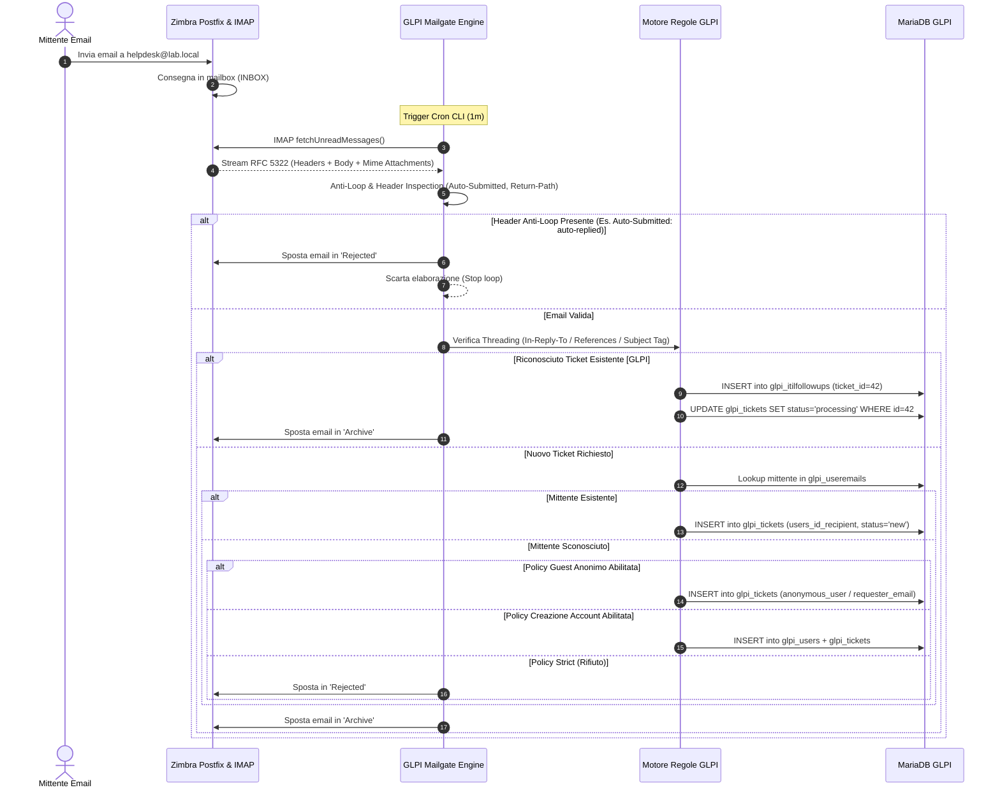

# Architettura Tecnica & Guida Funzionale: Integrazione GLPI 10.x & Zimbra Collaboration Suite

## 1. Executive Summary & Architecture Decision Record (ADR-001)

### 1.1 Contesto Operativo
Nel laboratorio di automazione `lab/zimbra-glpi/`, GLPI funge da piattaforma centrale di Service Management (ITSM/Ticketing), mentre Zimbra Collaboration Suite (versione Open Source 9/10 o 8.8.15) gestisce il ciclo vitale della posta elettronica e il servizio directory utenti (tramite OpenLDAP integrato).
L'obiettivo architetturale è consentire:
1. **Flusso Inbound (Email-to-Ticket)**: Apertura e aggiornamento automatico dei ticket tramite scansione programmata di una mailbox IMAP dedicata (`helpdesk@zimbra.local` o `support@lab.local`).
2. **Flusso Outbound (Notifiche)**: Recapito istantaneo di notifiche ed eventi di cambio stato dei ticket tramite Zimbra Postfix MTA via protocollo SMTP sicuro.
3. **Directory Sync & SSO (Fase Avanzata)**: Centralizzazione delle identità tramite l'OpenLDAP di Zimbra per autenticazione unificata e auto-provisioning degli account in GLPI.

### 1.2 Filosofia Architetturale: *"Everything fails all the time, plan for failure"*
- **Nessuna assunzione di disponibilità continua**: Se il container Zimbra è in riavvio o sovraccarico, il mailgate di GLPI deve fallire in modo controllato (circuit-breaker e backoff) senza corrompere lo stato dei messaggi o bloccare il cron di sistema.
- **Isolamento delle reti e Zero-Trust tra container**: Comunicazione su bridge Docker isolato (`lab_net`), con porte non esposte all'esterno se non necessarie.
- **Idempotenza e Threading Rigido**: Nessuna email di risposta deve generare un ticket duplicato; il parsing dei message ID RFC 5322 e degli header `In-Reply-To` garantisce che le comunicazioni confluiscano come follow-up nel thread originale.
- **Protezione Anti-Loop rigorosa**: Riconoscimento immediato di header di auto-risposta (`Auto-Submitted`, `X-Auto-Response-Suppress`) e bounce di sistema per scongiurare loop infiniti tra mailbox e risponditore automatico del service desk.

---

## 2. Topologia di Rete & Flusso dei Dati

### 2.1 Diagramma dei Flussi di Comunicazione

```mermaid
flowchart TD
    subgraph Zimbra_Suite["Zimbra Collaboration Suite (Container: zimbra)"]
        Z_MTA["Postfix MTA\n(Porta 25 Relay / 587 Submission)"]
        Z_IMAP["Zimbra Mailbox / Nginx IMAP\n(Porta 993 IMAPS / 143 IMAP)"]
        Z_LDAP["OpenLDAP Directory\n(Porta 389 LDAP / 636 LDAPS)"]
        Z_BOX[("Mailbox Storage\nhelpdesk@lab.local\n- INBOX\n- Archive\n- Rejected")]
    end

    subgraph GLPI_App["GLPI Service Desk (Container: glpi)"]
        G_CRON["GLPI Task Engine\n(bin/console glpi:task:cron)"]
        G_MAILGATE["Mailgate Receiver\n(IMAP Client c-client/php-imap)"]
        G_RULES["Mail Routing Engine\n(MIME Parser & Business Rules)"]
        G_CORE[("Database MariaDB/MySQL\n- glpi_tickets\n- glpi_itilfollowups\n- glpi_users")]
        G_NOTIF["Notification Mailer\n(PHPMailer SMTP Client)"]
        G_AUTH["Auth LDAP Provider\n(php-ldap Client)"]
    end

    %% Inbound Flow
    Z_IMAP <-->|Fetch Unread / Move Flag| G_MAILGATE
    G_CRON -->|Trigger Periodico (1-5m)| G_MAILGATE
    G_MAILGATE -->|Parsed Raw Email| G_RULES
    G_RULES -->|Create Ticket / Append Followup| G_CORE
    Z_BOX --- Z_IMAP

    %% Outbound Flow
    G_CORE -->|Trigger Evento / Notifica| G_NOTIF
    G_NOTIF -->|SMTP Auth / STARTTLS| Z_MTA

    %% Directory Flow
    G_AUTH -.->|LDAP Query / Sync| Z_LDAP
```

### 2.2 Matrice delle Connessioni e Porte di Rete

| Servizio Sorgente | Servizio Destinazione | Porta | Protocollo | Funzione Operativa | Fallback / Timeout Budget |
| :--- | :--- | :--- | :--- | :--- | :--- |
| `glpi` | `zimbra:993` | 993 | IMAPS (SSL/TLS) | Polling ricevitore email inbound | Timeout 30s; se timeout, log e retry al ciclo successivo |
| `glpi` | `zimbra:143` | 143 | IMAP + STARTTLS | Polling alternativo con STARTTLS | Obbligatorio `/novalidate-cert` per certificati lab autofirmati |
| `glpi` | `zimbra:587` | 587 | SMTP Submission | Invio notifiche con autenticazione | Queue interna GLPI; se rifiutato, retry differito |
| `glpi` | `zimbra:25` | 25 | SMTP Relay | Relay interno (limitato a subnet Docker) | Richiede configurazione `zimbraMtaMyNetworks` |
| `glpi` | `zimbra:389` | 389 | LDAP (STARTTLS) | Directory Sync utenti & SSO | Cache utenti locale; autenticazione fallback su DB GLPI |

---

## 3. Flusso Inbound: Configurazione Dettagliata Ricevitori (Mailgate)

### 3.1 Scheda di Configurazione del Ricevitore in GLPI
**Percorso Menu:** `Setup > Receivers` (`Configurazione > Ricevitori`) ➔ Cliccare su `+` (Aggiungi).

```yaml
Parametri Ricevitore:
  Nome: "Zimbra Helpdesk Inbound"
  Attivo: "Sì"
  Server: "mail.lab.local" # o 172.28.0.25 nel Docker network
  Tipo di server: "IMAP"
  Opzioni di connessione:
    - IMAP
    - SSL: "Sì" (o "TLS" se porta 143)
    - Convalida certificato (NO-VALIDATE-CERT): "Disattiva convalida" (CRUCIALE per ambienti lab con self-signed CA)
    - Porta: 993 (oppure 143 con STARTTLS)
  Stringa di connessione calcolata:
    "{mail.lab.local:993/imap/ssl/novalidate-cert}INBOX"
  Credenziali:
    Login / Utente: "helpdesk@lab.local"
    Password: "LabSecurePassword2026!"
  Cartelle IMAP:
    Cartella posta in arrivo: "INBOX"
    Cartella di archiviazione (Accepted): "Archive"
    Cartella di rifiuto (Refused/Rejected): "Rejected"
  Politiche di sicurezza:
    Dimensione massima allegati: 10485760 # 10 Megabyte (10 * 1024 * 1024)
    Estensioni escluse: "exe,bat,cmd,vbs,js,scr,pif,msi,jar,ps1"
```

> [!IMPORTANT]
> **Pre-requisito sulle cartelle IMAP Zimbra**: Le cartelle `Archive` e `Rejected` **devono esistere preventivamente** nella casella Zimbra prima di abilitare l'archiviazione nel ricevitore GLPI.
> Crearle da webmail Zimbra (`https://localhost:8444`) oppure da CLI Zimbra:
> ```bash
> zmmailbox -z -m helpdesk@lab.local createFolder /Archive
> zmmailbox -z -m helpdesk@lab.local createFolder /Rejected
> ```

### 3.2 Pianificazione e Automazione del Polling (Azione Automatica `mailgate`)

Per garantire un'elaborazione tempestiva senza dipendere dal traffico web degli operatori, l'azione `mailgate` deve essere impostata esclusivamente in modalità **CLI**.

**Configurazione in GLPI:**
1. Menu: `Setup > Automatic actions` (`Configurazione > Azioni automatiche`).
2. Selezionare l'azione `mailgate`.
3. Configurare:
   - **Modalità di esecuzione**: `CLI` (NON `GLPI`).
   - **Frequenza di esecuzione**: `1 minuto`.
   - **Stato**: `Abilitato`.
   - **Periodo di esecuzione**: `00:00 - 24:00`.
   - **Numero di email da elaborare per esecuzione**: `20` (limite batch per prevenire timeout di PHP).

**Crontab di Sistema (già integrato nell'entrypoint del container GLPI):**
```cron
* * * * * www-data /usr/local/bin/php /var/www/html/glpi/front/cron.php --force=1 > /dev/null 2>&1
```

**Comando di Scansione Manuale per Debug/Test Immediato:**
```bash
docker exec -u www-data -it lab-glpi php /var/www/html/glpi/bin/console glpi:task:cron --force mailgate
```

---

## 4. Regole di Business, MIME Parsing & Routing Engine

### 4.1 Diagramma Sequenziale di Routing Inbound



### 4.2 Risoluzione del Mittente e Policy per Utenti Sconosciuti

1. **Riconoscimento Utente Registrato**:
   - GLPI interroga la tabella `glpi_useremails`.
   - Se l'indirizzo `From:` coincide con l'email di un utente attivo, il ticket viene creato associando quell'utente come **Richiedente (`Requester`)**.
   - Vengono ereditati i gruppi e le entità dell'utente.

2. **Gestione Mittente Sconosciuto (`Unknown Sender`)**:
   In `Setup > General > Assistance` (`Configurazione > Generale > Assistenza`):
   - **Opzione A: Strict Enterprise (Consigliata per ambienti interni chiusi)**:
     - Impostazione: *Rifiuta email da utenti non registrati*.
     - Risultato: Il messaggio viene spostato nella cartella `Rejected`. Nessun ticket aperto. Nessun rischio di spam injection.
   - **Opzione B: Auto-Provisioning Utenti (Self-Service)**:
     - Impostazione: *Aggiungi automaticamente utenti esterni tramite email* = `Sì`.
     - Profilo assegnato di default: `Self-Service` (privilegi minimi, sola consultazione propri ticket).
     - Entità assegnata: `Root entity` (o sotto-entità designata).
   - **Opzione C: Guest Ticket con Assegnazione a Utente Generico**:
     - Impostazione: *Consenti creazione anonima* = `Sì`.
     - Il ticket viene intestato a un utente generico di sistema (es. `helpdesk-guest`), inserendo l'indirizzo email originale nell'intestazione del corpo del ticket.

### 4.3 Threading, Riconoscimento Risposte & Prevenzione Duplicati

GLPI implementa un doppio meccanismo di threading RFC-compliant per correlare le risposte ai ticket aperti:

1. **Header MIME RFC 2822 / RFC 5322 (`In-Reply-To` e `References`)**:
   - Ogni notifica generata da GLPI include un `Message-ID` univoco nel formato:  
     `<GLPI-ticket-0000123-65a8b9c@lab.local>`
   - Quando il client di posta del richiedente risponde, include automaticamente:
     ```http
     In-Reply-To: <GLPI-ticket-0000123-65a8b9c@lab.local>
     References: <GLPI-ticket-0000123-65a8b9c@lab.local>
     ```
   - GLPI effettua il parsing di questi header ed estrae direttamente l'ID del ticket (#123), allegando il nuovo messaggio come `ITILFollowup` (Seguito).

2. **Regex Fallback sull'Oggetto (Subject Matching)**:
   - Se il client di posta non preserva gli header MIME, GLPI scansiona l'oggetto dell'email con una regex canonica:
     ```regex
     \[GLPI #([0-9]{7})\]
     ```
   - Esempio di oggetto: `Re: [GLPI #0000042] Stampante di rete bloccata`.
   - L'identificativo `0000042` reindirizza il messaggio al ticket #42.

3. **Comportamento su Ticket Risolti/Chiusi**:
   - Se il ticket associato è in stato `Risolto` (`Solved`) o `In Attesa` (`Waiting`), l'arrivo di una risposta via email riapre automaticamente il ticket reimpostandolo sullo stato `In Lavorazione (assegnato)` (`Processing / Assigned`).

### 4.4 Meccanismi Anti-Loop e Protezione da Mail Flooding

1. **Filtro Header Auto-Submitted & Suppress**:
   GLPI rifiuta o ignora le email che contengono:
   ```http
   Auto-Submitted: auto-replied
   Auto-Submitted: auto-generated
   X-Auto-Response-Suppress: All
   Precedence: bulk
   Precedence: junk
   ```
2. **Filtro Mail Delivery Subsystem / Bounce**:
   - Mittenti scartati di default: `MAILER-DAEMON@*`, `postmaster@*`, `noreply@*`.
   - Header di ritorno vuoto: `Return-Path: <>`.
3. **Soglia Anti-Loop Built-in (`Max emails per timeframe`)**:
   - Parametro in `Setup > Receivers`: **Max emails in X minutes** (es. massimo `10 email in 5 minuti` dallo stesso mittente).

---

## 5. Flusso Outbound: Configurazione Notifiche SMTP via Zimbra Postfix

### 5.1 Scheda di Configurazione del Server SMTP in GLPI
**Percorso Menu:** `Setup > Notifications > Mail server configuration` (`Configurazione > Notifiche > Configurazione del server di posta`).

```yaml
Parametri Server di Notifica:
  Modalità di invio: "SMTP"
  Host SMTP: "mail.lab.local" # o 172.28.0.25 nel Docker network
  Porta: 587 # STARTTLS consigliato (oppure 465 SSL, o 25 se relay non autenticato)
  Autenticazione SMTP: "Sì"
  Utente SMTP: "helpdesk@lab.local"
  Password SMTP: "LabSecurePassword2026!"
  Tipo di cifratura: "TLS" # STARTTLS
  Verifica certificato SSL (Check certificate): "No" # Evita blocco su certificati autofirmati lab
  
  Indirizzi Mittente Standard:
    Email amministratore: "helpdesk@lab.local"
    Nome mittente: "GLPI Service Desk Support"
    Email di risposta (Reply-To): "helpdesk@lab.local"
```

---

## 6. Integrazione Avanzata: Zimbra OpenLDAP ➔ Sincronizzazione Utenti GLPI

### 6.1 Parametri di Collegamento LDAP in GLPI
**Percorso Menu:** `Setup > Authentication > LDAP directories` (`Configurazione > Autenticazione > Directory LDAP`).

```yaml
Configurazione Directory LDAP:
  Nome: "Zimbra OpenLDAP"
  Server predefinito: "Sì"
  Attivo: "Sì"
  Server: "mail.lab.local"
  Porta: 389
  Usa TLS (STARTTLS): "No" # Oppure "Sì" con CA installata
  BaseDN: "ou=people,dc=lab,dc=local"
  RootDN (Bind User): "uid=zimbra,cn=admins,cn=zimbra" # O utente dedicato read-only
  RootDN Password: "<Zimbra_Admin_Password>"
  Filtro di connessione (Search Filter):
    "(&(objectClass=zimbraAccount)(zimbraAccountStatus=active))"
  Campo di login (Login Field): "uid" # Login con username 'm.rossi'
  
Associazione Campi (Field Mapping):
  Cognome (Surname): "sn"
  Nome (First name): "givenName"
  Email: "mail"
  Telefono: "telephoneNumber"
  Titolo / Posizione: "title"
```

### 6.2 Automazione Sincronizzazione via CLI
```bash
# Sincronizzazione periodica utenti LDAP
docker exec -u www-data -it lab-glpi php bin/console glpi:ldap:synchronize_users --ldap-server-id=1

# Import iniziale account attivi
docker exec -u www-data -it lab-glpi php bin/console glpi:ldap:import_users --ldap-server-id=1
```

---

## 7. Failure Modes & Troubleshooting

| Sintomo / Anomalia | Causa Radice | Strategia di Risoluzione |
| :--- | :--- | :--- |
| **`Connection failure: Certificate failure`** | GLPI rifiuta il certificato autofirmato emesso dalla CA locale di Zimbra. | Aggiungere `/novalidate-cert` nella stringa del ricevitore IMAP (`{mail.lab.local:993/imap/ssl/novalidate-cert}INBOX`), oppure disattivare `Check certificate` in SMTP. |
| **`Relay access denied` durante l'invio SMTP** | Zimbra Postfix non riconosce l'IP del container GLPI tra le reti ammesse e l'autenticazione è assente o errata. | Verificare credenziali via porta 587, oppure aggiornare `zimbraMtaMyNetworks` in Zimbra per includere la subnet `172.28.0.0/16`. |
| **Il ricevitore scarica la stessa email all'infinito** | La cartella `Archive` specificata non esiste sul server IMAP. | Creare manualmente la cartella `Archive` con `zmmailbox -z -m helpdesk@lab.local createFolder /Archive`. |
| **Ticket duplicati per ogni email di risposta** | Il client email del mittente rimuove i tag `[GLPI #...]` e non include gli header `In-Reply-To` / `References`. | Assicurarsi che i template di notifica GLPI mantengano intatti `[GLPI ###ticket.id##]` e l'header standard `Message-ID`. |
