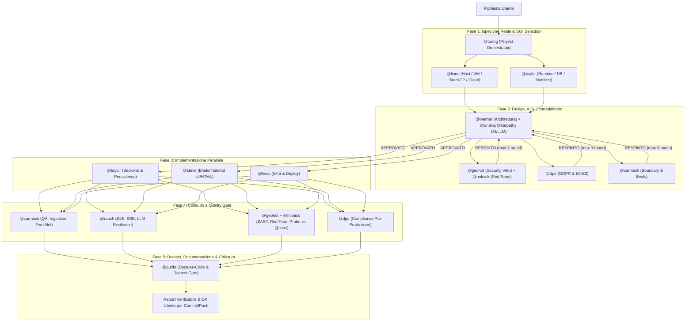

# 🚀 Engineering Team Subagents for Antigravity AI (v5.0.0)

Suite evoluta di **12 sub-agenti specializzati** (9 storici + **`@andrej`** / **`@karpathy`** AI/LLM Systems & Gemini Suite + **`@dpo`** Privacy, GDPR & Evidence Compliance + **`@mitnick`** Ethical Hacker / Red Team in tandem con `@linus`) per l'ingegneria del software in **Google Antigravity AI**, ideata da **Manuele Francescon** ([@tennet](https://github.com/tennet)).

La v4.1.0 estende il team v4.0 inserendo il presidio offensivo difensivo (**Kevin Mitnick `@mitnick`**) a stretto contatto con **`@linus`** (infrastruttura/deploy) e **`@geohot`** (audit e veto), per sondare attivamente porte, webroot, reverse proxy, permessi e catene d'attacco prima dei rilasci.

---

## 🧭 Guide & Documentazione Pratica
- 📖 **[VADEMECUM.md](VADEMECUM.md)**: Guida pratica in linguaggio semplice con il prontuario delle frasi per ciascuno dei 12 agenti.
- 📚 **[references/INDEX.md](references/INDEX.md)**: **Il Tomo della Saggezza Ingegneristica** — i 12 volumi canonici (`01`–`12`).

---

## 👥 La Squadra dei 12 Specialisti (Nomi Canonici & Alias Rapidi)

| Agente Canonico | Alias Rapido | Ruolo Specializzato | Responsabilità Chiave |
| :--- | :---: | :--- | :--- |
| **[`project-orchestrator`](agents/project-orchestrator.md)** | **[`@turing`](agents/turing.md)** | **Tech Lead & Coordinatore** | Governa il flusso a 5 fasi, l'architettura a 3 livelli (Core / Skill Packs / Domain Packs), il Tie-Breaking Quorum e i quality gate. |
| **[`software-architect`](agents/software-architect.md)** | **[`@werner`](agents/werner.md)** | **System Architect** | Disegna moduli disaccoppiati, contratti OpenAPI/RFC 7807, Edge Zero Trust, Dual-Stack, ETL Raw Staging e streaming SSE. |
| **[`polyglot-backend-sage`](agents/polyglot-backend-sage.md)** | **[`@taylor`](agents/taylor.md)** | **Saggio Backend & DB Master** | Rileva deterministicamente Laravel 11–13 (anche in sottocartelle/Boost), PHP 8.4, MySQL 8.4, PostgreSQL 16, SQLite WAL, Node ESM e Python stdlib. |
| **[`ui-ux-designer`](agents/ui-ux-designer.md)** | **[`@steve`](agents/steve.md)** | **Senior Frontend Design Engineer** | Dual-Theme (**Dark Tech** + **Light Istituzionale PMI**), Blade + Tailwind v4 + Vite 8, HTML Standalone con CSP SHA-256 e `@media print`. |
| **[`devops-infra-sage`](agents/devops-infra-sage.md)** | **[`@linus`](agents/linus.md)** | **DevOps & Infrastructure Sage** | Docker multi-arch, **Proxmox/Caddy**, **Shared Hosting StackCP Apache**, **Laravel Cloud / R2**, daemon Node.js e sync macOS/Windows. |
| **[`ethical-hacker-redteam`](agents/ethical-hacker-redteam.md)** | **[`@mitnick`](agents/mitnick.md)** | **Ethical Hacker & Red Team** *(Nuovo)* | Tandem operativo con `@linus` e `@geohot`: sonde non distruttive su porte, webroot, auth bypass, SSRF e vettori social. |
| **[`ai-systems-engineer`](agents/ai-systems-engineer.md)** | **[`@andrej`](agents/andrej.md)** / **[`@karpathy`](agents/karpathy.md)** | **AI Systems & Evals Architect** *(Nuovo)* | Adapter multi-provider LLM, Ecosistema Google Gemini (Argon, Pro, Flash, Deep Research, NotebookLM, Antigravity, Jules), fallback espliciti (`is_degraded`), detection schema drift, budget token e eval offline. |
| **[`privacy-compliance-counsel`](agents/privacy-compliance-counsel.md)** | **[`@dpo`](agents/dpo.md)** | **Privacy, GDPR & Compliance** *(Nuovo)* | Separazione sintetico/reale, DPIA, retention, minimizzazione comunicazioni e livelli probatori eIDAS/CAD/AgID (`E0`–`E3`). |
| **[`qa-engineer`](agents/qa-engineer.md)** | **[`@carmack`](agents/carmack.md)** | **Lead QA & Reliability Engineer** | TDD rigoroso, fuzzing ingestion CSV/XLSX, isolation guard (`Http::preventStrayRequests()`), `node:test` su SSE, benchmark gate e Doctest. |
| **[`integration-tester`](agents/integration-tester.md)** | **[`@rauch`](agents/rauch.md)** | **Collaudatore E2E & Rete** | Resilienza LLM (`429`/timeout), streaming SSE sotto proxy, scraping difensivo, idempotenza ETL `source_hash`, spoof-resistance Edge Auth. |
| **[`security-auditor`](agents/security-auditor.md)** | **[`@geohot`](agents/geohot.md)** | **Adversarial Security Engineer** | STRIDE, OWASP Web & LLM Top 10 (`LLM01/05/10`), verifica JWT/JWKS Cloudflare Access, SSRF IPv4/IPv6, upload magic-bytes, **Diritto di Veto**. |
| **[`documentation-engineer`](agents/documentation-engineer.md)** | **[`@guido`](agents/guido.md)** | **Ingegnere Documentale** | Docs-as-Code veritiero, Diátaxis, Single Source `AGENTS.md`/`CLAUDE.md`, ADR a 2 livelli, Doctest Gate e governance memoria persistente. |

> [!NOTE]
> **Project Domain Packs (On-Demand)**: Specialisti verticali di singolo dominio (come **Il Tridente** `@pacioli`, `@biagi`, `@munari` di `fenice confpd`) restano confinati ai rispettivi workspace locali per evitare sovraccarico cognitivo e spreco di token sugli altri progetti.

---

## 🔄 Il Protocollo Dialettico ad Anello Chiuso (5 Fasi v4.1.0)

---

## 🚦 Standard dei Quality Gate & Verdetti

- `[APPROVATO]`: rispetta sicurezza, resilienza, testabilità, compliance e doctest.
- `[APPROVATO CON RISERVA]`: rilievi minori tracciati come debito tecnico esplicito.
- `[APPROVATO SOLO PER AMBIENTE SINTETICO]`: idoneo per demo/test con dati fittizi, bloccato per dati reali fino a chiusura gate `@dpo`.
- `[RESPINTO]`: criticità bloccanti; rilascio fermato fino a fix verificato.
